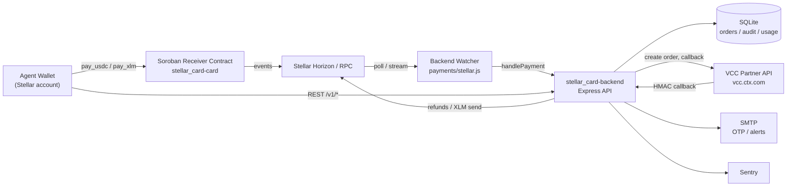
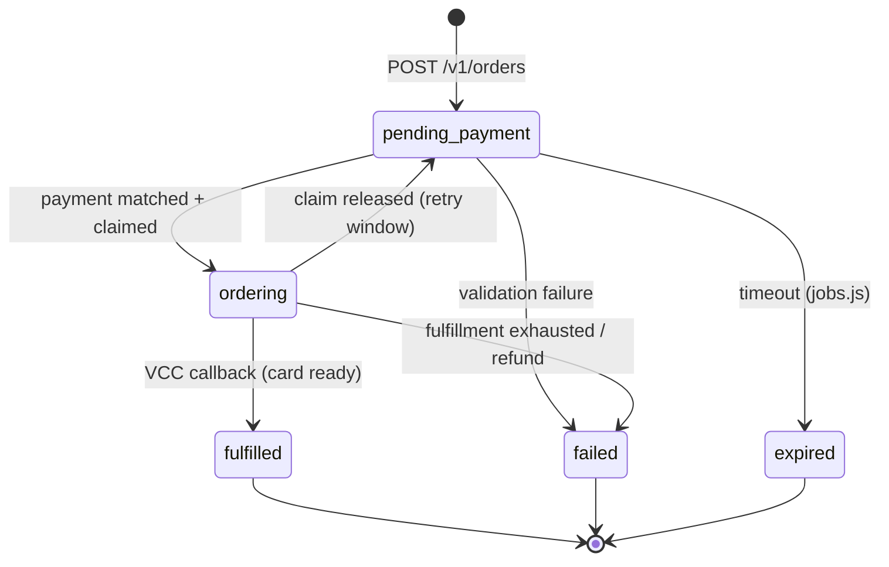

# Backend Architecture

Technical reference for `stellar_card-backend` — the USDC/XLM-to-VCC fulfillment
engine. Companion documents:

- [Environment reference](./env-reference.md) — every configuration knob
- [Payment flow](./PAYMENT_FLOW.md) — payment-handler internals and failure modes
- [Payment handler](./PAYMENT_HANDLER.md) — claim/fulfill/reconcile detail
- [Routing](./ROUTING.md) — the mount table
- [Request validation](./REQUEST_VALIDATION.md) — input hardening
- [Database testing](./DATABASE_TESTING.md) — SQLite schema and test harness
- [Sentry setup](./SENTRY_SETUP.md) — error-tracking configuration

## System overview

### Component responsibilities

| Component | Role |
|-----------|------|
| **Agent wallet** | Pays the receiver contract in USDC or XLM for a card order. |
| **Soroban receiver contract** | Holds payment, forwards funds to the treasury, emits `pay_usdc`/`pay_xlm` events tagged with an order id. |
| **Horizon / Soroban RPC** | Public Stellar data plane; the watcher polls it for contract events. |
| **Backend watcher** | `src/payments/stellar.js` turns on-chain events into `handlePayment()` invocations. |
| **Express API** | Order lifecycle, agent auth, dashboards, MPP (feature-flagged). |
| **SQLite** | Source of truth for orders, audit log, usage counters, unmatched payments. |
| **VCC partner** | Creates and scrapes the virtual Visa card; posts an HMAC-signed callback. |
| **SMTP** | Login OTPs, approval requests, spend alerts. |
| **Sentry** | Error and performance telemetry (optional). |

## API surface

Mounted in [`src/routes/index.js`](../src/routes/index.js). Full OpenAPI
spec: [`openapi.json`](../openapi.json) (Swagger UI at `/api-docs` when enabled).

| Prefix | Auth | Purpose |
|--------|------|---------|
| `/health`, `/status`, `/api/version` | none | Liveness and build info |
| `/auth/*` | session / OTP | Dashboard email-OTP login |
| `/v1/agent/*` | API key | Agent identity, claim, status |
| `/v1/orders` | API key | Create and read card orders |
| `/v1/usage`, `/v1/policy/check` | API key | Spend visibility and policy gates |
| `/v1/mpp/*`, `/v1/cards/*` | mixed | Machine Payments Protocol (off by default) |
| `/dashboard/*` | operator session | Operator console |
| `/internal/*` | internal email | Break-glass tooling (card reveal, refunds) |
| `/vcc-callback` | HMAC | VCC → backend fulfillment callback |

## Payment state machine

### Status meanings

| Status | Meaning |
|--------|---------|
| `pending_payment` | Order created; waiting for an on-chain payment of at least the quoted amount. |
| `ordering` | Payment matched; a worker is creating the card with VCC. |
| `fulfilled` | Card details delivered (revealable via the claim / internal endpoints). |
| `failed` | Terminal failure; treasury refunded when funds had been taken. |
| `expired` | Payment never arrived before the order timeout. |

## Order creation → card reveal lifecycle

1. **Create order** — Agent `POST /v1/orders` with product, amount, and asset
   (`usdc_soroban` or `xlm_soroban`). The API validates policy (spend limits,
   approvals), inserts an order row in `pending_payment`, and returns the
   receiver contract address plus a memo/order id.
2. **Pay on-chain** — Agent calls `pay_usdc` or `pay_xlm` on the receiver
   contract for the exact order id. The contract forwards funds to the treasury
   and emits a payment event.
3. **Watch** — `payments/stellar.js` polls Horizon/RPC, decodes the event, and
   invokes `handlePayment()` with the order id, payer, asset, and amount.
4. **Validate & claim** — The handler checks order existence and status,
   compares the paid amount to the quote (underpayment is quarantined as an
   unmatched payment), then flips the order to `ordering`.
5. **Fulfill** — A worker calls the VCC partner to create the virtual card.
   `jobs.js` retries transient failures up to `MAX_FULFILLMENT_ATTEMPTS`.
6. **Callback** — VCC posts the card payload to `/vcc-callback`, signed with
   `VCC_CALLBACK_SECRET`. The handler verifies the HMAC, seals the card
   details with `CARDS402_SECRET_BOX_KEY`, and marks the order `fulfilled`.
7. **Reveal** — The agent redeems the claim (`/v1/agent/claim`) and receives
   the one-time card details; operators can also reveal via
   `/internal/orders/:id/card`. Reveal is audited.

Failure at steps 4–6 routes the order to `failed` and triggers a treasury
refund; every branch is recorded in `unmatched_payments` or the audit log.

## Security policies

| Control | Implementation |
|---------|----------------|
| API-key auth for `/v1/*` | `middleware/auth.js` — constant-time key compare, per-key rate limits |
| Dashboard auth | Email OTP (`/auth/login` → `/auth/verify`), session cookie |
| Internal tools | `INTERNAL_EMAILS` allow-list + `@stellar_card.com` suffix |
| CORS | `CORS_ORIGINS` parsed at boot; `corsDenial` middleware rejects the rest |
| HTTPS enforcement | Non-development environments refuse plain HTTP |
| Secrets at rest | `CARDS402_SECRET_BOX_KEY` AES-256-GCM seals claim payloads |
| Webhook authenticity | HMAC-SHA256 of the raw body (`VCC_CALLBACK_SECRET`, `PARTNER_WEBHOOK_SECRET`) |
| SSRF | `lib/ssrf.js` guards outbound fetches |
| Rate limiting | `express-rate-limit` on auth, agent, and operator surfaces |
| Audit | `lib/audit.js` records actor, IP, user-agent, and target |

## Database schema (summary)

SQLite via `better-sqlite3`; migrations run at boot from `src/db.js`.

| Table | Purpose |
|-------|---------|
| `orders` | Card orders and their payment/fulfillment status |
| `unmatched_payments` | On-chain payments that could not be applied |
| `audit_log` | Append-only security/audit trail |
| `usage` | Per-agent spend counters |
| `agents` / `api_keys` | Agent identity and key material |
| `approvals` | Operator approval queue for policy-gated spends |
| `webhook_log` | Inbound VCC/partner callback log |

See [DATABASE_TESTING.md](./DATABASE_TESTING.md) for the full schema and test
harness notes.

## Troubleshooting

| Symptom | Likely cause | Fix |
|---------|--------------|-----|
| Container fails at boot with `[env] Invalid environment variables` | Missing/invalid required env var | Compare with [env-reference.md](./env-reference.md); the message names the exact key |
| `WEBHOOK_SIGNATURE_BYPASS=true is not allowed in production` | Bypass flag left on | Remove the flag from the production environment |
| `CARDS402_SECRET_BOX_KEY is required in production` | Key unset | `openssl rand -hex 32` and set the variable |
| Healthcheck failing / `docker compose up --wait` hangs | App not listening on `PORT`, or crashed on boot | `docker logs stellar_card-backend`; confirm `PORT` matches the published port |
| Orders stuck in `pending_payment` | Watcher not seeing events | Check `SOROBAN_RPC_URL` reachability and watcher logs; confirm the payment memo/order id |
| Orders stuck in `ordering` | VCC callback never arrived or HMAC failed | Inspect `webhook_log`; verify `VCC_CALLBACK_SECRET` matches the partner |
| Payments in `unmatched_payments` | Underpayment, unknown order id, or wrong asset | Query the table's `reason` column; see [PAYMENT_FLOW.md](./PAYMENT_FLOW.md) failure modes |
| SMTP errors on login OTP | Partial SMTP config | Set all of `SMTP_HOST`, `SMTP_PORT`, `SMTP_USER`, `SMTP_PASS`, `SMTP_FROM` together |
| CORS errors from the dashboard | Origin not in `CORS_ORIGINS` | Add the exact origin (`https://app.example.com`), comma-separated |
| `better-sqlite3` fails to load in the container | Native module built on a different libc | Rebuild the image (`docker compose build --no-cache`); the builder stage must compile on Alpine |
